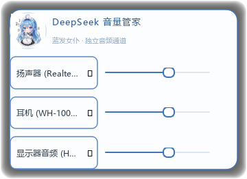

# DeepSeek 音量管家（蓝发女仆主题悬浮音量控制器）

一个常驻桌面的 Windows 音量控制器，采用「桌面宠物」形态：无边框、圆角、始终置顶、不出现在任务栏。在素色极简版基础上，顶部加入**蓝发女仆拟人立绘**装饰，并将描边、滑块、文案统一为深蓝色系。可分别对最多 3 个输出设备进行音量调节。



## 运行环境

- 操作系统：Windows 10 / 11（x64）
- Python：3.9 及以上（建议 3.10+）
- 依赖：`PySide6`、`pycaw`、`comtypes`

## 安装与启动

1. 安装依赖：
   ```bat
   pip install -r requirements.txt
   ```
2. 启动（推荐，无控制台窗口）：

   双击 `启动DeepSeek音量管家.bat`。

   该脚本使用 `pythonw.exe` 启动，不会弹出黑色控制台窗口，程序以后台托盘形式常驻。脚本会优先使用项目内的 `.venv` 虚拟环境（若已创建），否则使用系统 PATH 中的 `pythonw`。
3. 命令行启动（可见输出，便于排错）：
   ```bat
   python main.py
   ```

## 操作说明

- **调节音量**：拖动每行的圆形滑块，改变该行绑定设备的系统音量（0–100%）。拖动时滑块右侧以浅灰小字显示百分比。
- **选择设备**：点击左侧圆角设备框，弹出下拉列表（含「↻ 刷新设备」），选择系统中任意播放/输出设备。
- **拖动窗口**：在窗口任意非滑块区域（设备框、边距、行间隙等）按住鼠标左键即可拖动。在设备框上是「短按弹出设备列表、长按拖动移动窗口」，两者自动区分。
- **缩放窗口**：将鼠标移到窗口四边或四角，光标变为对应缩放样式，按住拖动即可缩放；最小尺寸约 320×232。
- **右键菜单**：在窗口任意位置右键，包含：
  - 置顶开关
  - 透明度（100% / 90% / 80%）
  - 锁定位置与大小
  - 重置窗口位置
  - 刷新设备列表
  - 退出
- **托盘图标**：右下角托盘使用女仆立绘图标，菜单含「显示/隐藏」与「退出」；点击图标也可切换显示。
- **切换主输出**：在设备框上**双击**，将该设备设为系统默认（主）输出设备；当前系统主输出设备名后会带「★」标记。切换后右下角托盘会弹出气泡提示。
- **边缘缩放光标**：鼠标贴近窗口四边或四角时，光标会自动变为对应样式（上下=垂直、左右=水平、四角=沿对角线），提示可拖拽缩放。
- **系统音量实时跟随**：当系统音量被**其它程序或系统本身**改变时（任务栏喇叭、音量混音器、快捷键、其它软件），浮窗内对应设备的滑块会**实时自动跟随**到最新音量，无需手动刷新。这是通过注册 Windows Core Audio 的 `IAudioEndpointVolumeCallback` 系统音量变化通知实现的，并在音频服务线程与主线程之间用 Qt 信号安全桥接。

## 特性

- **三组独立**：默认自动绑定前 3 个可用输出设备；不足时其余显示「选择设备」。允许多行绑定同一设备，滑块自动同步。
- **设备健壮性**：设备被拔出/禁用时不会崩溃，UI 标记为「设备不可用」，可通过刷新重新选择。
- **配置持久化**：窗口位置、大小、每行绑定的设备 ID、透明度、置顶与锁定状态，写入  
  `%APPDATA%/DesktopVolumeControllerMaid/config.json`（若系统目录不可写则回退到程序目录下的 `config.json`）。重启自动恢复。与素色版配置相互隔离。
- **主题装饰**：顶部为蓝发女仆拟人立绘 + 「DeepSeek 音量管家」标题；窗口描边、设备框、滑块与百分比文字统一为深蓝色系。
- **立绘容错**：若 `deepseek_maid.png` 缺失，顶部装饰自动降级为「♫」符号、托盘图标回退为自绘扬声器，不影响任何功能。

## 文件结构

```
volume-controller-maid/
├── main.py                   入口：COM 初始化、加载配置、启动窗口
├── audio_manager.py          音频设备枚举与音量读写、主输出切换（接触 comtypes 之一）
├── volume_callback.py        系统音量变化回调（IAudioEndpointVolumeCallback）+ Qt 信号桥接（接触 comtypes 之二）
├── widgets.py                DeviceSelector（设备选择框）、VolumeSlider（自定义滑块）
├── volume_window.py          主窗口：无边框/置顶/拖动/缩放/右键菜单/托盘/布局/实时跟随/顶部立绘装饰
├── config.py                 配置读写（JSON，容错）
├── deepseek_maid.png         蓝发女仆拟人立绘（顶部装饰 + 窗口/托盘图标）
├── requirements.txt          PySide6, pycaw, comtypes
├── 启动DeepSeek音量管家.bat   pythonw 无控制台启动（可移植，无需写死路径）
└── README.md                 本说明
```

## 已知限制

- 仅支持**播放（输出/render）**&#x8BBE;备，暂不支持录制（输入）设备。
- 透明度降低后，圆角投影会一并变淡。
- 由于使用 `Qt.Tool`，程序不出现在任务栏，只能通过托盘或右键菜单退出；如进程异常残留，可在任务管理器结束 `pythonw.exe`。
- 在远程桌面 / 某些虚拟音频环境下，设备枚举结果可能为空。
